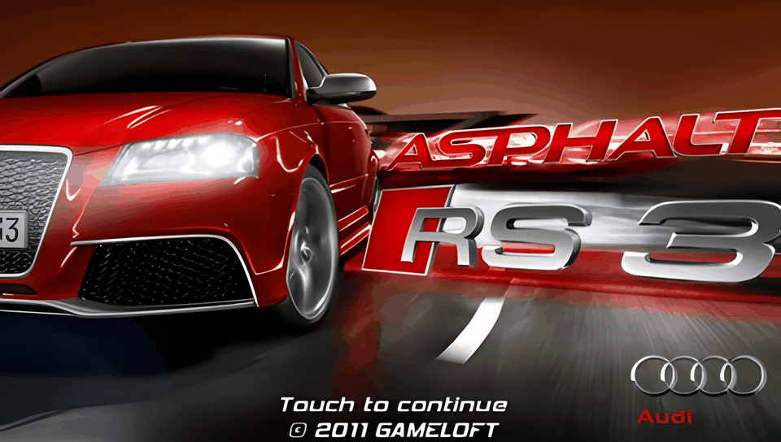

<h1 align="center">
  <br>
  Asphalt Audi RS 3 · PS Vita Port
</h1>

<p align="center">
  <b>Native port of Asphalt Audi RS 3 (Gameloft) for PlayStation Vita and PlayStation TV.</b>
</p>

<p align="center">
  
  
  
  
  
  
</p>

<p align="center">
  <a href="#-description">Description</a> •
  <a href="#-features">Features</a> •
  <a href="#-controls">Controls</a> •
  <a href="#-installation">Installation</a> •
  <a href="#-known-issues">Known Issues</a> •
  <a href="#-building-from-source">Build</a> •
  <a href="#-credits">Credits</a>
</p>

---

## 📖 Description

**Asphalt Audi RS 3** is Gameloft's racing game built around the Audi RS 3 Sportback, on the Asphalt 6 engine
(urban tracks in Tokyo and the Bahamas). This port runs the original 32-bit ARMv7 iOS executable
(`AsphaltAudiRS3`, from the iOS v1.0.1 IPA, bundle `com.gameloft.AsphaltAudiRS3`) directly on the PS Vita's
ARM Cortex-A9 processor. There is no `.so`, no JNI and no Java in this port.

The port ships its own **Mach-O loader** (`source/macho.c`), which maps the decrypted executable at a fixed base
(`MACHO_SLIDE = 0x98000000`), applies the rebase data, resolves the import tables and binds stubs for unhandled
symbols. Native Vita code replaces the Apple frameworks the game uses: Darwin libc/pthreads, a mini Objective-C
and UIKit runtime, OpenGL ES 1.1/2.0 on [vitaGL](https://github.com/Rinnegatamante/vitaGL), OpenAL on
openal-soft, and CoreAudio/AudioToolbox emulation on `sceAudioOut`.

### Loader Architecture

| Component | File(s) | Role & Emulation Functionality |
|---|---|---|
| **Mach-O Loader** | `source/macho.c`, `source/macho.h` | Custom static dyld and 32-bit Mach-O executable loader with fixed base address (`MACHO_SLIDE = 0x98000000`). Applies data segment rebases, resolves import tables (`__la_symbol_ptr`, `__nl_symbol_ptr`), and binds stubs for unhandled symbols. |
| **Assembly Glue & Trampolines** | `source/asm.S` | `call_guest` and `call_guest6` (preserve `r9`). `ml_align_call` (bridges iOS 4-byte stack alignment to VitaSDK/newlib 8-byte AAPCS). `ml_unimpl_entry` (auto-logging unimplemented stub). |
| **Darwin / POSIX Subsystem** | `source/darwin.c`, `source/darwin.h` | Darwin libc, libgcc, pthreads, and sockets emulation. Thread-safe POSIX wrapper with `SceUID` tracking. High-precision `mach_absolute_time()` mapped to `sceKernelGetProcessTimeWide()`. |
| **Variadic Formatter** | `source/darwin_printf.c`, `source/darwin_printf.h` | Printf engine tailored to Darwin's ARM ABI: reads 64-bit doubles and integers from unaligned word boundaries, with support for Objective-C's `%@` specifier. |
| **Mini-runtime ObjC / UIKit** | `source/objc.c`, `source/objc.h`, `source/uikit.c`, `source/foundation.c` | Selector-based dispatch with `objc_msgSend` and `objc_msgSend_stret`. Emulates the Foundation and UIKit classes the game uses, including the on-screen keyboard via `sceImeDialog`. |
| **OpenGL ES Graphics Backend** | `source/gles.c`, `source/gles.h`, `source/vitagl_no_splash.c` | GLES1 and GLES2 pipeline powered by vendored `vitaGL` compiled with `SOFTFP_ABI=1`. Converts `GL_FIXED` vertex arrays and disables blocking splashscreens. |
| **CgBI PNG Decoder** | `source/cgbi.c`, `source/cgbi.h` | Native decompressor and BGR-to-RGB converter for Apple's CgBI-optimized PNG assets, so intact IPA bundles load without offline conversion. |
| **Audio** | `source/openal.c`, `source/audio.c`, `source/coreaudio.c` | OpenAL, AudioQueue/AudioFile over `.ogg` music, AudioUnit RemoteIO and AudioSession emulation. |
| **Cutscenes** | `source/movie.c`, `source/movie.h` | Movie playback for `MPMoviePlayerController` calls. |
| **Input Subsystem** | `source/input.c`, `source/input.h` | Maps PS Vita buttons, sticks and the front/rear touch panels to iOS touch events (`UITouchPhaseBegan`, `Moved`, `Ended`). |
| **Options Menu** | `source/options.c`, `source/options.h` | In-game port menu opened with SELECT + START (see [Options](#-options)). |
| **Logging Subsystem** | `source/log.c`, `source/log.h` | Rotating on-device file logger (`ux0:data/asphalt-audirs3/logs/`) and live stdout streaming. |
| **Game Patches & Glue** | `source/patch.c`, `source/patch.h`, `source/port_config.h` | Game-specific memory patches, symbol redirection and build-time switches. |

### Critical iOS on PS Vita ABI Rules

1. **`r9` as a Scratch Register**: in Apple's Darwin ARMv6/v7 ABI `r9` is a scratch register; in the ARM AAPCS
   used by VitaSDK/newlib it is callee-saved or platform-reserved. The loader is compiled with `-ffixed-r9`, and
   every transfer into the game binary goes through `call_guest` / `call_guest6` in `source/asm.S`.
2. **SoftFP Calling Convention**: iOS 32-bit binaries pass floats in integer registers (`r0..r3`), so `vitaGL`
   is built with `SOFTFP_ABI=1`.
3. **4-Byte Stack Alignment**: iOS code enforces only 4-byte stack alignment, while VitaSDK newlib expects 8 bytes.
   C callbacks invoked by the game enter through `ml_align_call`.
4. **FairPlay DRM Decryption**: the Mach-O executable must be fully decrypted (`cryptid = 0`). An encrypted binary
   crashes with a Data Abort as soon as it is loaded.

---

## 🎮 Status & Playability

**Status: In-game (v01.00, from IPA v1.0.1)**

On physical hardware the port boots, draws the game and reaches races. Race frame rate is well below the original,
and some visuals are still wrong (see [Known Issues](#-known-issues)).

- [x] **Mach-O loader**: loads the executable at `0x98000000` with 8529 rebase words and 1268 unique imports
  (`PORTING_PLAN.md`). *Verified on console.*
- [x] **Graphics**: GLES 1.x / 2.0 → vitaGL. Race frames logged at about 21–27 FPS (`asphalt-audirs3_020.log`).
  *Verified on console.*
- [x] **Touch**: touches are dispatched to the game's `EAGLView` (touch lines in the logs). *Verified on console.*
- [ ] **Physical buttons and steering**: mapped through `controls.txt` and the steering option; <!-- TODO: confirm in game -->.
- [ ] **Audio**: OpenAL and AudioQueue paths are implemented; <!-- TODO: confirm the latest build with sound -->.
- [ ] **Saves**: iOS `Documents/` is mapped to `ux0:data/asphalt-audirs3/Documents/`; <!-- TODO: confirm persistence -->.
- [ ] **Main menu navigation and control options**: not verified yet (`PORTING_PLAN.md`).

### Changelog / fixes

- **Options menu (SELECT + START)**: added with the iPhone profile, steering modes, on-screen buttons and FPS
  options. The FPS options are *not yet tested on console*.
- **Car bodies**: with `DRAW_SPEEDHACK=2` (`SAFER_DRAW_SPEEDHACK`) the car bodies rendered broken in the
  three races of logs 017–019. That mode was removed; only `SAMPLERS_SPEEDHACK=1` remains (log 020).
- **Steering**: the left stick / D-Pad steers with a virtual finger at (0.2 | 0.8, 0.45) on the touch screen. The
  button-based steering is documented in the options menu.

---

## ✨ Features

| Feature | Status | Notes |
| :--- | :---: | :--- |
| Boots to gameplay | ✅ | Boots and reaches races on console (`asphalt-audirs3_NNN.log`). |
| Graphics / renderer | 🟡 | vitaGL, GLES 1.x / 2.0. About 21–27 FPS in the logged races; car body rendering was broken in an earlier speed-hack mode (removed). |
| Audio & music | 🧪 | OpenAL and AudioQueue paths in `source/`; <!-- TODO: confirm on latest build -->. |
| Video / cutscenes | 🧪 | `source/movie.c` present; <!-- TODO: confirm on console -->. |
| Physical buttons | 🧪 | Defaults in `controls.txt` (see Controls); <!-- TODO: confirm in game -->. |
| Analog sticks / camera | 🧪 | Left stick steering through the virtual finger; <!-- TODO: confirm -->. |
| Touch screen | ✅ | Touch events reach the game's `EAGLView` on console. |
| Button remapping / port menu | 🟡 | The SELECT + START menu opens on console; remapping and the FPS options are not verified yet. |
| Save data | 🧪 | Mapped to `ux0:data/asphalt-audirs3/Documents/`; <!-- TODO: confirm persistence -->. |
| Native trophies | ❌ | No trophy support documented in this repo. |
| Languages | ❔ <!-- TODO --> | Not documented in this repo. |
| Performance | 🟡 | About 21–27 FPS in race (`PERF` lines, `asphalt-audirs3_020.log`). |
| Online / IAP / ads | ➖ | Not documented. Online frameworks (GameKit, SystemConfiguration) are linked by the game but not part of this port's scope. |
| PS TV | 🧪 | Same VPK; not tested on PS TV. |

Legend: `✅ Working (verified on console) · 🧪 Implemented, not yet verified on console · 🟡 Partial · ❌ Not working · ➖ Not applicable · ❔ Not documented yet`

---

## 🎯 Controls

| Vita input | Action |
|---|---|
| Right trigger (R) | Gas (accelerate) |
| Left trigger (L) | Brake |
| Cross | Nitro |
| Square | Brake (alternative) |
| Circle | Gas (alternative) |
| Start | Pause |
| Left stick / D-Pad left-right | Steering (virtual finger / tilt, see options) |
| Touchscreen | Touch input for menus and HUD |
| Select + Start | Port options menu |

Bindings are read from `ux0:data/asphalt-audirs3/controls.txt` (one `BUTTON x y action` line per binding, coordinates
on the 480x320 landscape screen). The file can be edited over FTP, and Select + Start also changes it.

---

## 📋 Prerequisites

To run this port on your PS Vita or PS TV, you will need:

1. A PS Vita / PS TV running Custom Firmware (**HENkaku** or **Enso**).
2. [**kubridge**](https://github.com/TheOfficialFloW/kubridge/releases) installed as a kernel plugin
   (`ur0:tai/config.txt` under `*KERNEL`).
3. [**libshacccg.suprx**](https://github.com/Rinnegatamante/ShaRKBR33D/releases/latest) installed in `ur0:data/`.
4. A legally obtained copy of **Asphalt Audi RS 3** for iOS, version **1.0.1**, decrypted (`cryptid 0`).

---

## 📦 Installation

1. Install `asphalt_audirs3.vpk` on your console with **VitaShell**.
2. Take the decrypted `Payload/AsphaltAudiRS3.app` folder from your own IPA.
3. Stage the data with the port's tooling (see [Building from Source](#-building-from-source)). This creates
   `rebase.bin`, `binds.bin`, `nib.txt`, `nibs/` and `controls.txt`.
4. Copy the result to `ux0:data/asphalt-audirs3/` over VitaShell or FTP.
5. Launch the game from the LiveArea.

### Final File Structure in `ux0:data/asphalt-audirs3/`

```text
ux0:data/asphalt-audirs3/
├── game_app/        <- the decrypted AsphaltAudiRS3.app folder from your IPA
├── rebase.bin       <- rebase table generated from the executable
├── binds.bin        <- binding table generated from the executable
├── nib.txt          <- MainWindow nib, precompiled
├── nibs/            <- other precompiled nibs
├── controls.txt     <- button bindings (editable by hand)
├── options.txt      <- port options (created by the options menu)
├── Documents/       <- save games (iOS Documents/ folder)
└── logs/            <- runtime logs (asphalt-audirs3_NNN.log), crash dumps (.psp2dmp)
```

### ⚙️ Options

The game pauses behind the menu. D-pad ↑/↓ moves between rows, ←/→ or ✕ changes a value, ○ saves and closes.
Settings are saved to `ux0:data/asphalt-audirs3/options.txt`.

| Option | Values | Notes |
| :--- | :--- | :--- |
| **Screen size** | original aspect · full screen | |
| **Screen filter** | bilinear · sharp bilinear | |
| **Anti-aliasing (MSAA)** | off · 2x · 4x | Applies after restarting the game. |
| **Rotation** | none · landscape right · landscape left | |
| **On-screen buttons** | shown · hidden | Hides the game's pedals/nitro/pause during races; they keep working. |
| **Steering** | tilt + touch sides · tilt only · touch sides only | Stick / d-pad steering mode. |
| **iPhone profile** | iPhone 2G … iPod touch 3G | Older profile = lighter graphics. Applies after restarting. |
| **Controls** | one row per `controls.txt` action | Pick the Vita button for each on-screen action. |
| **FPS counter / limit** | off · counter · limit 30 · counter + limit 30 | New, *not yet tested on console*. Counter in the top-left corner; the limit caps the game at 30 FPS. Saved as `show_fps=` / `fps_cap=`. |

---

## 🐛 Known Issues

- **Frame rate**: about 21–27 FPS in logged races (`PERF` lines). The FPS limit and counter in the options menu
  are not yet tested on console.
- **Car bodies**: rendered broken with the older `DRAW_SPEEDHACK=2` mode (logs 017–019); that mode was removed.
- **Unverified features**: physical-button steering, save persistence, sound on the latest build, and main-menu
  navigation are still to be confirmed on console.
- **Logs and crash dumps**: runtime logs are in `ux0:data/asphalt-audirs3/logs/` (`asphalt-audirs3_NNN.log`).
  Crash dumps (`asphalt-audirs3-psp2core-*.psp2dmp`) are written by the system to `ux0:data/`. Attach the newest
  log and dump when reporting a bug.

---

## 🔨 Building from Source

This port does **not** keep a local copy of `porting_tools/`. Build, deploy, log and LiveArea workflows are handled
by **psvita-port-toolkit**, a standalone tool kept outside this repository.

### Build Prerequisites

- [VitaSDK](https://vitasdk.org) (`$VITASDK`) with `kubridge`, `vitashark` and `pthread`.
- CMake and Make.
- vitaGL is **vendored** in `vendor/vitaGL` and built automatically with `SOFTFP_ABI=1`. Do not use VitaSDK's
  prebuilt `libvitaGL.a`.
- The decrypted `.app` folder, linked as `game_app` in the repo root (never committed).

### Build Steps

```bash
# Configure and compile the VPK:
cmake -B build
cmake --build build
```

This produces `build/asphalt_audirs3.vpk` and `build/eboot.bin`. The repo root also has a `build.sh`
<!-- TODO: document its options -->. For day-to-day development (build, deploy, crash-dump parsing) use
**psvita-port-toolkit**, the standalone tool that manages this port.

The LiveArea images are mapped into `sce_sys/` by `vita_create_vpk` in `CMakeLists.txt`. The Title ID is `PSVAUDIRS`
and the VPK version is `01.00`.

Architecture and progress notes: [`PORTING_PLAN.md`](PORTING_PLAN.md) and [`port_progress.md`](port_progress.md).

---

## 📁 Project Structure

- `source/`: native loader: Mach-O loader, ABI glue, Darwin and ObjC/UIKit runtime, GLES, audio, input, options.
- `vendor/vitaGL/`: vitaGL built from source (`SOFTFP_ABI=1`).
- `extras/livearea/`: LiveArea assets (`pic0.png` is the banner).
- `docs/`: generated Mach-O report (`macho_report.txt`).
- `logs/`: runtime logs and crash dumps pulled from the console.
- `decompiled/`: local analysis output (not game assets).
- `PORTING_PLAN.md`: living plan: binary facts, frameworks, phases.
- `port_progress.md`: bug-by-bug progress log.
- `CLAUDE.md`: working notes for AI-assisted development.

---

## 📜 Disclaimer

**Asphalt Audi RS 3** is a trademark of **Gameloft**. The work presented in this repository is unofficial and is not
produced, endorsed, or sanctioned by Gameloft or any affiliated entities.

This software does NOT contain original game code, binaries, graphics, or other game assets. The authors do not
promote or condone piracy in any way. To play, you must provide your own legally obtained, **decrypted** copy of
the iOS `.ipa`.

---

## ☕ Support My Work

This project is **free** and will stay free. If you enjoy it, a tip from **$1** helps me keep porting games to the PS Vita:

<p align="center">
  <a href="https://ko-fi.com/metalsyntax"></a>
</p>

- **Ko-fi:** [ko-fi.com/metalsyntax](https://ko-fi.com/metalsyntax)
- **PayPal:** [paypal.me/MetalSyntax](https://paypal.me/MetalSyntax)
- **Bitcoin (BTC):** `133HdCsaWxdjTfmwpgGVykByhNBV338uRc`

**Ko-fi supporters get:**
- **Early access** to new ports before their public release (test builds of upcoming projects).
- **Data preparation scripts and step-by-step guides** to set up your own game files for each new port.
- A say in which games I port next.

> Game files are never distributed. You always need your own legally obtained copy of the game.

---

## 👥 Credits

- **Gameloft**: original developer of Asphalt Audi RS 3.
- **MetalSyntax**: this port.
- **TheFloW**: `kubridge` and foundational techniques for loading native code on PS Vita.
- **Rinnegatamante**: [`vitaGL`](https://github.com/Rinnegatamante/vitaGL) and [`vitaShaRK`](https://github.com/Rinnegatamante/ShaRKBR33D).
- **Bythos**: [`kubridge`](https://github.com/bythos14/kubridge).
- **Inotia2-vita** and **ios-loader-boilerplate**: the iOS Mach-O loader architecture this port is built on.
- The PS Vita homebrew and porting community.

---

## 📄 License

<!-- TODO: no LICENSE file in this repository. Add the license text and holder before publishing. -->
